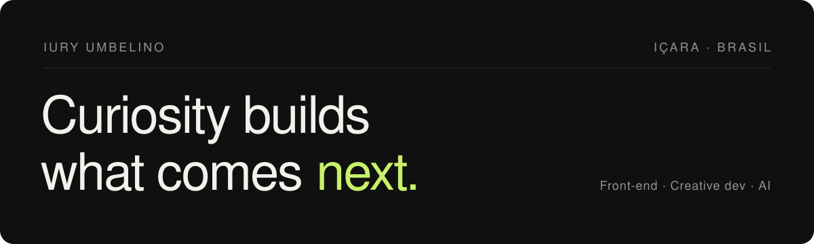

I'm **Iury Umbelino**, a developer from Içara, Brazil. I build web products end to end, from the problem and the interface to the code and the deploy, and I use AI coding agents as part of how I work: I define the problem, write the directives, orchestrate the work and test the result.

By day I'm an IT Assistant at Giassi Supermercados, working with Oracle (SQL and PL/SQL) and automations on the DOX platform. I study Computer Science (UNESC) and Systems Analysis and Development (UNOPAR), and I run [SOU Studio](https://soustudio.com.br), my independent studio for websites, visual identity and digital solutions.

<b>PT</b> · Desenvolvedor em Içara (SC). Construo produtos web do problema ao deploy, com agentes de IA no processo. Assistente de TI no Giassi, estudante de Ciência da Computação e ADS, fundador da SOU Studio.

---

### Selected work

**01 · [Koinonia](https://usekoinonia.com.br)** · LIVE 
A community-management web platform (PWA) for churches and communities: people, attendance and care. My role: product builder, from the problem and the flows to AI directives, orchestration and testing. 
TanStack Start · React 19 · Supabase · Tailwind CSS v4 · Vitest

**02 · [Portfolio](https://github.com/Umbelino-dev/Iury-Umbelino---Portif-lio-)** · PRE-LAUNCH 
My new portfolio: an editorial, bilingual (PT/EN) static site with a night-to-day scroll transition, a portrait reveal, case studies and a scripted cat assistant. 
Next.js 16 · TypeScript · Tailwind CSS v4 · GSAP · next-intl · Cloudflare

**03 · [Via Hebraica](https://viahebraica.app)** · LIVE 
A Bible-study web app with a reader, atlas, timeline and bookmarks.

**04 · [SOU Studio](https://soustudio.com.br)** · LIVE 
Website of my studio: web development, visual identity and digital solutions for local businesses.

Most product code is private. Happy to walk through it in a conversation.

### Stack

| | |
| :-- | :-- |
| **Front-end** | TypeScript · React 19 · Next.js · TanStack Start · Tailwind CSS v4 · GSAP |
| **Back-end & data** | Supabase · Oracle · SQL · PL/SQL |
| **Platform** | Vercel · Cloudflare Workers · GitHub Actions |
| **AI-assisted development** | Claude Code and coding agents, with project context files (`CLAUDE.md`, `AGENTS.md`) |
| **Design** | UI, visual identity and branding through SOU Studio |

### Now

- Launching the new portfolio.
- Evolving Koinonia with the communities that use it.

### Contact

[umbelino.vercel.app](https://umbelino.vercel.app) · [LinkedIn](https://www.linkedin.com/in/iuryumbelino/) · [iuryumbelino1@gmail.com](mailto:iuryumbelino1@gmail.com)
